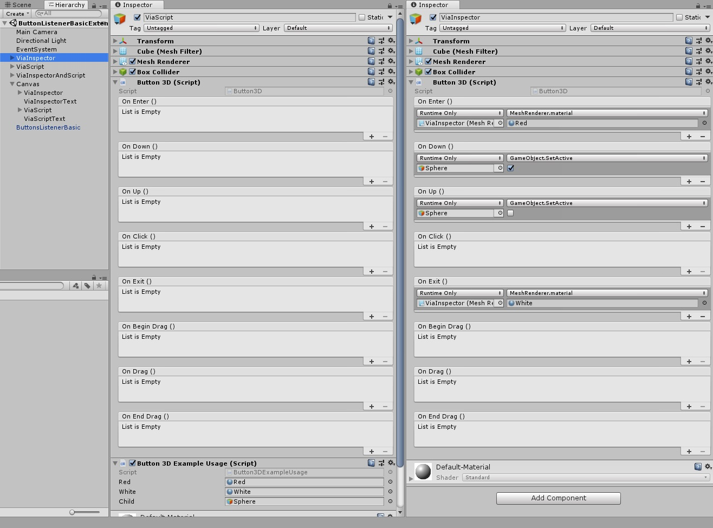
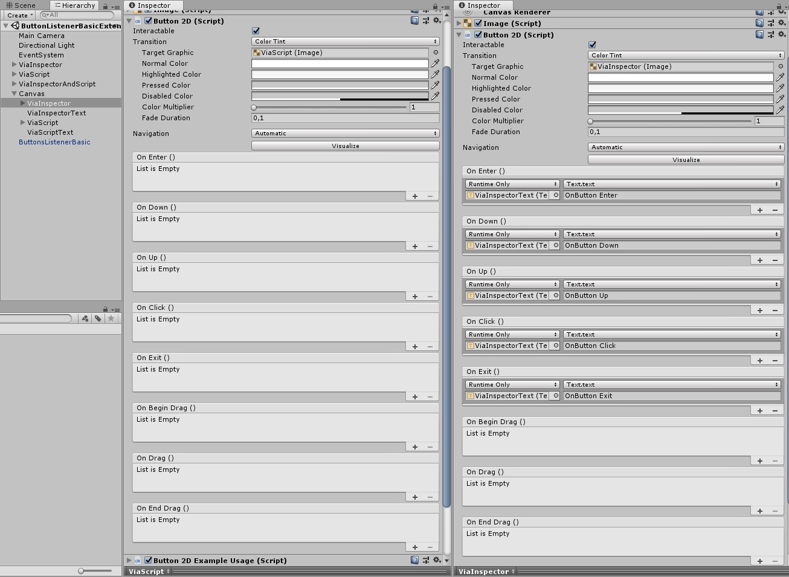

# Extended Buttons

A Unity package that adds advanced pointer and drag events to both 3D GameObjects and UI Buttons - without manual raycasting or `OnMouse*` workarounds.

---

## Features

- **Button3D** - attach button behaviour to any 3D object with a `Collider`
- **Button2D** - extends Unity's `Button` with `onEnter`, `onDown`, `onUp`, and `onExit` events
- **Button2DExtended** - all of `Button2D` plus full drag event support
- **Zero-config listener** - `ButtonsListenerBasic` is created automatically at runtime via a singleton; no manual setup required
- Mouse and touch input supported

---

## Installation

### Asset Store

Open the Unity Asset Store and click **Add to My Assets**:
`https://assetstore.unity.com/packages/tools/integration/extended-buttons-152732`

### Unity Package Manager

Open **Window → Package Manager**, click **+ → Add package from git URL…** and paste:

```
https://github.com/ostrzolekpawel/UnityExtendedButtons.git?path=Assets/ExtendedButtons/Assets
```

### manifest.json

Add the entry directly to `Packages/manifest.json`:

```json
{
    "dependencies": {
        "com.osirisgames.unityextendedbuttons": "https://github.com/ostrzolekpawel/UnityExtendedButtons.git?path=Assets/ExtendedButtons/Assets"
    }
}
```

---

## Quick Start

### Button3D

1. Add a `Collider` component to your 3D GameObject.
2. Add the `Button3D` component to the same GameObject.
3. Subscribe to events - the listener is created automatically, no prefab needed.

```csharp
var button = GetComponent<Button3D>();

button.onClick.AddListener(() => Debug.Log("Clicked!"));
button.onEnter.AddListener(() => Debug.Log("Hover enter"));
button.onExit.AddListener(() => Debug.Log("Hover exit"));
```

### Button2D

Replace the standard `Button` component with `Button2D` to gain access to additional pointer events:

```csharp
var button = GetComponent<Button2D>();

button.onClick.AddListener(() => Debug.Log("Clicked!"));
button.onDown.AddListener(() => Debug.Log("Pointer down"));
button.onUp.AddListener(() => Debug.Log("Pointer up"));
```

---

## Components

### Button3D

Turns any 3D object into an interactive button. Requires a `Collider` on the same GameObject.

**Events**

| Event | Trigger |
|---|---|
| `onEnter` | Pointer moves over the collider |
| `onDown` | Pointer button pressed while over the collider |
| `onUp` | Pointer button released |
| `onClick` | Pointer released without significant movement (see `moveThreshold`) |
| `onExit` | Pointer leaves the collider |
| `onBeginDrag` | Pointer movement exceeds the drag threshold while held down |
| `onDrag` | Called every frame while dragging |
| `onEndDrag` | Pointer released after a drag was initiated |

**Properties**

| Property | Type | Default | Description |
|---|---|---|---|
| `Interactable` | `bool` | `true` | Enables or disables all event responses |

**Inspector**



**Example**

```csharp
using UnityEngine;
using ExtendedButtons;

public class MyButton3D : MonoBehaviour
{
    [SerializeField] private Material hoverMaterial;
    [SerializeField] private Material defaultMaterial;
    [SerializeField] private GameObject pressIndicator;

    private void Start()
    {
        var button = GetComponent<Button3D>();
        var meshRenderer = GetComponent<MeshRenderer>();

        button.onEnter.AddListener(() => meshRenderer.material = hoverMaterial);
        button.onExit.AddListener(() => meshRenderer.material = defaultMaterial);

        button.onDown.AddListener(() => pressIndicator.SetActive(true));
        button.onUp.AddListener(() => pressIndicator.SetActive(false));

        button.onClick.AddListener(() => Debug.Log("Button3D clicked"));

        button.onBeginDrag.AddListener(() => Debug.Log("Drag started"));
        button.onDrag.AddListener(() => Debug.Log("Dragging..."));
        button.onEndDrag.AddListener(() => Debug.Log("Drag ended"));
    }
}
```

---

### Button2D

Extends Unity's built-in `Button` with additional pointer events. Requires a Canvas and `ICanvasElement`.

**Inspector**



**Events**

| Event | Trigger |
|---|---|
| `onEnter` | Pointer enters the button rect |
| `onDown` | Pointer pressed down |
| `onUp` | Pointer released |
| `onClick` | Inherited from Unity's `Button` |
| `onExit` | Pointer leaves the button rect |

**Example**

```csharp
using UnityEngine;
using UnityEngine.UI;
using ExtendedButtons;

public class MyButton2D : MonoBehaviour
{
    [SerializeField] private Text statusText;

    private void Start()
    {
        var button = GetComponent<Button2D>();

        button.onEnter.AddListener(() => statusText.text = "Hover");
        button.onDown.AddListener(() => statusText.text = "Pressed");
        button.onUp.AddListener(() => statusText.text = "Released");
        button.onClick.AddListener(() => statusText.text = "Clicked");
        button.onExit.AddListener(() => statusText.text = "");
    }
}
```

---

### Button2DExtended

Inherits all functionality from `Button2D` and adds drag events. Use this instead of `Button2D` when you need swipe or drag interactions on UI elements.

**Additional Events**

| Event | Trigger |
|---|---|
| `onBeginDrag` | Drag gesture begins |
| `onDrag` | Called every frame while dragging |
| `onEndDrag` | Drag gesture ends |

**Example**

```csharp
using UnityEngine;
using UnityEngine.UI;
using ExtendedButtons;

public class MyButton2DExtended : MonoBehaviour
{
    [SerializeField] private Text statusText;

    private void Start()
    {
        var button = GetComponent<Button2DExtended>();

        button.onEnter.AddListener(() => statusText.text = "Hover");
        button.onDown.AddListener(() => statusText.text = "Pressed");
        button.onUp.AddListener(() => statusText.text = "Released");
        button.onClick.AddListener(() => statusText.text = "Clicked");
        button.onExit.AddListener(() => statusText.text = "");

        button.onBeginDrag.AddListener(() => statusText.text = "Begin Drag");
        button.onDrag.AddListener(() => statusText.text = "Dragging");
        button.onEndDrag.AddListener(() => statusText.text = "End Drag");
    }
}
```

---

## Listener System (Button3D)

`Button3D` events are driven by a listener that casts a ray from the camera each frame. The package manages this automatically - a `ButtonsListenerBasic` singleton is created at runtime if none exists in the scene.

### ButtonsListenerBasic

The default listener. Configure it via the Inspector when you need to override defaults.

| Field | Type | Default | Description |
|---|---|---|---|
| `button3DCamera` | `Camera` | `Camera.main` | Camera used for raycasting; falls back to `Camera.main` if not set |
| `moveThreshold` | `float` | `4.0` | Pixel distance the pointer must travel to suppress `onClick` and begin a drag |
| `maxDistance` | `float` | `100.0` | Maximum raycast distance |
| `layerMask` | `LayerMask` | `Default` | Layers included in the raycast |
| `acceptClickAfterMove` | `bool` | `true` | When `true`, `onClick` fires even if the pointer moved, as long as it is still over the same button on release |

> **Note:** UI elements block the raycast - if the pointer is over a UI element, no `Button3D` events are fired.

### Custom Listener

To replace the default listener with your own implementation, inherit from `ButtonsListenerMono` and override `Listener()`. Call `ListenerSingleton.SetInstance()` to register it before the default singleton is created.

```csharp
using UnityEngine;
using ExtendedButtons;

public class MyCustomListener : ButtonsListenerMono
{
    public override void Listener()
    {
        // Your custom input logic here
    }
}
```

```csharp
// Register before the default singleton is created (e.g., Awake with low Script Execution Order)
ListenerSingleton.SetInstance(myCustomListenerInstance);
```

Alternatively, place a `ButtonsListenerBasic` (or your custom listener) prefab in the scene - the singleton will find it automatically and skip creating a new one.

---

## API Reference

### Button3D

| Member | Type | Description |
|---|---|---|
| `Interactable` | `bool` property | Enables/disables event responses |
| `onEnter` | `UnityEvent` | Pointer hover enter |
| `onDown` | `UnityEvent` | Pointer press down |
| `onUp` | `UnityEvent` | Pointer release |
| `onClick` | `UnityEvent` | Click (no significant movement) |
| `onExit` | `UnityEvent` | Pointer hover exit |
| `onBeginDrag` | `UnityEvent` | Drag start |
| `onDrag` | `UnityEvent` | Drag update (every frame) |
| `onEndDrag` | `UnityEvent` | Drag end |
| `Init()` | `void` | Initialises all events; called automatically in `Awake()` |

### Button2D

| Member | Type | Description |
|---|---|---|
| `onEnter` | `UnityEvent` | Pointer hover enter |
| `onDown` | `UnityEvent` | Pointer press down |
| `onUp` | `UnityEvent` | Pointer release |
| `onClick` | `UnityEvent` | Inherited from Unity's `Button` |
| `onExit` | `UnityEvent` | Pointer hover exit |
| `Init()` | `virtual void` | Initialises all events; called automatically in `Awake()` |

### Button2DExtended

Inherits all members from `Button2D`, plus:

| Member | Type | Description |
|---|---|---|
| `onBeginDrag` | `UnityEvent` | Drag start |
| `onDrag` | `UnityEvent` | Drag update (every frame) |
| `onEndDrag` | `UnityEvent` | Drag end |

### ListenerSingleton

| Member | Type | Description |
|---|---|---|
| `SetInstance(IButtonsListener)` | `static void` | Overrides the active listener instance |

---
